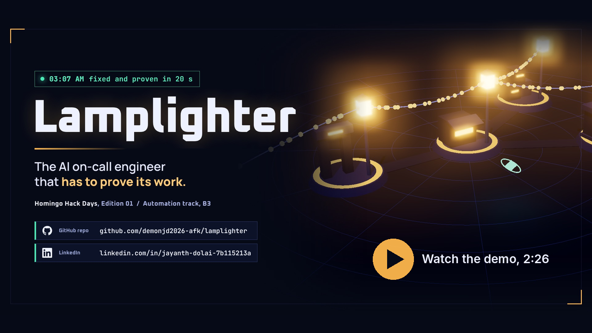
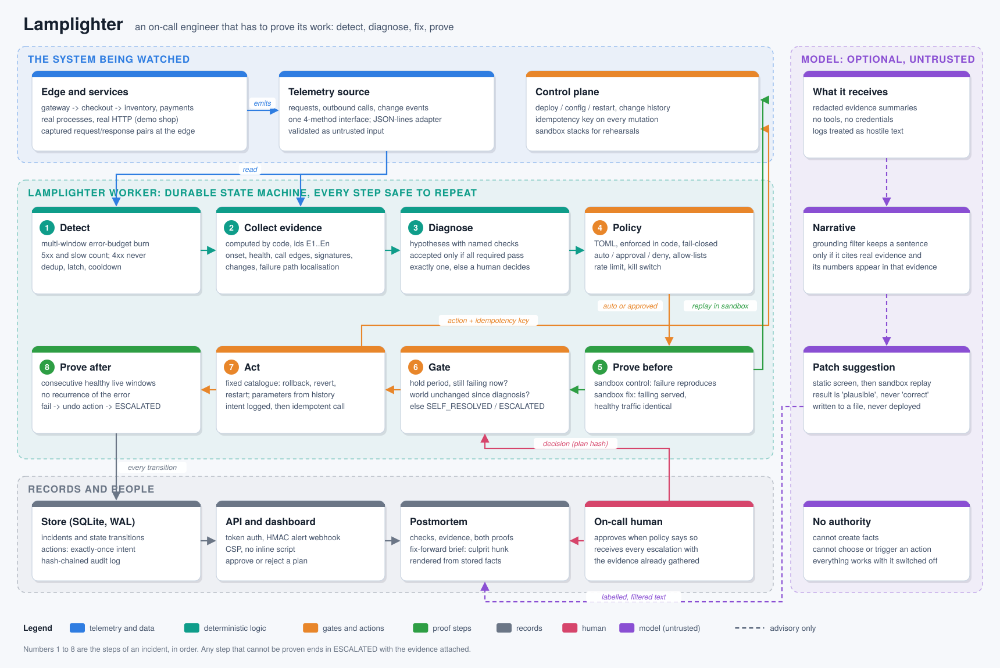
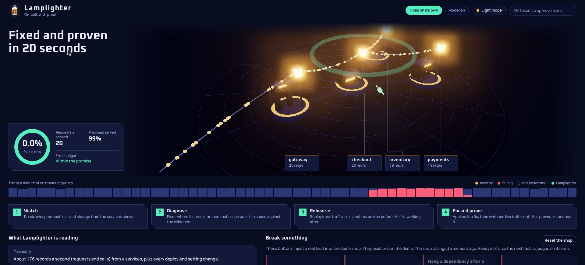
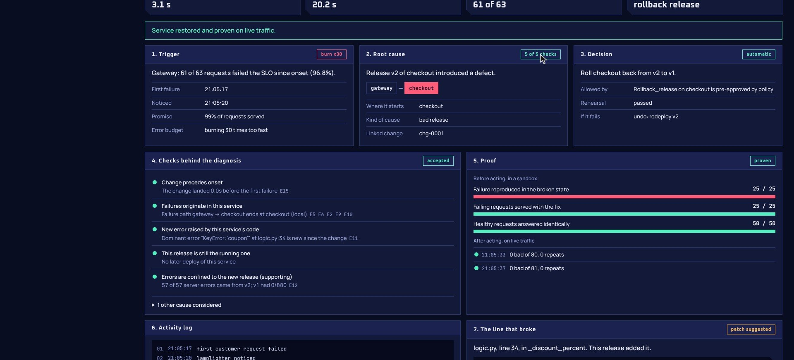

<p align="center">
  <a href="https://youtu.be/LVmSNv-wg_0"></a>
</p>

<h1 align="center">Lamplighter</h1>

<p align="center"><strong>An on-call engineer that has to prove its work.</strong><br>
It watches a running system, finds the root cause of a failure, ships the fix, and proves on recorded and live
traffic that the fix worked. When it cannot prove something, it does not act: it hands a human the evidence.</p>

<p align="center">
  <a href="https://youtu.be/LVmSNv-wg_0"><strong>Demo video (2:26)</strong></a> ·
  <a href="#quickstart"><strong>Quickstart</strong></a> ·
  <a href="docs/EVALUATION.md"><strong>Evaluation</strong></a> ·
  <a href="docs/MODEL_EVALUATION.md"><strong>Model evaluation</strong></a> ·
  <a href="docs/ARCHITECTURE.md"><strong>Architecture</strong></a> ·
  <a href="docs/THREAT_MODEL.md"><strong>Threat model</strong></a>
</p>

<p align="center">
  <a href="https://youtu.be/LVmSNv-wg_0"></a>
  
  
  <a href="docs/EVALUATION.md"></a>
  <a href="docs/MODEL_EVALUATION.md"></a>
  <a href="LICENSE"></a>
</p>

Built by [Jayanth Dolai](https://www.linkedin.com/in/jayanth-dolai-7b115213a/) for **Homingo Hack Days, Edition 01**,
Automation track, problem statement **B3: The AI on-call engineer**.

## Contents

- [Demo](#demo)
- [At a glance](#at-a-glance)
- [The problem](#the-problem)
- [What it does](#what-it-does)
- [Results](#results)
- [Architecture](#architecture)
- [How it stays safe](#how-it-stays-safe)
- [Quickstart](#quickstart)
- [The dashboard](#the-dashboard)
- [Tests and evaluation](#tests-and-evaluation)
- [Project layout](#project-layout)
- [AI tools, models and libraries used](#ai-tools-models-and-libraries-used)
- [Limitations](#limitations)
- [What's next](#whats-next)
- [Hackathon submission](#hackathon-submission)
- [Licence](#licence)

## Demo

**[▶ Watch on YouTube (2:26)](https://youtu.be/LVmSNv-wg_0)**: a broken release is detected, rolled back and proven fixed in 20 seconds;
the case file shows the root cause, the checks and the proof; the model's patch and notes are shown with their
guardrails; then a failure it cannot fix is handed to a human.

The video shows one real session of the demo shop, recorded with `claude-haiku-5-5` switched on: the incidents,
timings, model notes and patch on screen are what that run produced. The dashboard was rendered frame by frame
from that recording, because the machine used for capture has no graphics card.

## At a glance

| | |
|---|---|
| **What it does** | Detects an SLO breach, diagnoses the root cause, rehearses the fix in a sandbox, applies it, and proves it on live traffic |
| **When it will not act** | No hypothesis passes all its checks, the fix fails rehearsal, policy does not allow it, or the system has already recovered. Then it escalates with the evidence |
| **Actions it can take** | Roll back a release, revert a config value, restart a service. A fixed catalogue, under a policy enforced in code |
| **Role of the AI model** | Optional. Writes the incident narrative and suggests a patch. It cannot create a fact or trigger an action |
| **Guard on the model** | Only sentences that cite real evidence with matching numbers survive; a patch is screened and replayed in a sandbox, never deployed |
| **Measured** | 24 of 24 correct responses over 8 fault scenarios, 0 wrong actions; 350 of 350 planted fabrications dropped; model narratives scored with DeepEval |
| **Self-checks** | 103 fast tests, 3 end-to-end tests against real processes, a threat model with a test behind each control |
| **Stack** | Python 3.11+, FastAPI, SQLite; three.js dashboard; the demo shop is standard-library Python |
| **Needs to run** | Python only. No account, API key or container |

## The problem

When software breaks at 3 AM, a person still wakes up, reads logs, traces the cause and ships a fix. Most of
what they need is already in the logs, the metrics, the code and the change history.

Handing that job to a language model alone does not work: it will name a plausible cause that is wrong, and
act on it. An automated responder is only useful if it can be trusted, which means every claim it makes has to
point at evidence, every action has to be rehearsed first, and "I don't know" has to be an allowed answer.

Lamplighter is built around that constraint. Decisions are made by coded checks over collected evidence. The
model is kept to writing, and what it writes is filtered.

## What it does

For teams that run services and carry a pager. When the edge starts failing its SLO, Lamplighter:

| Step | What happens |
|---|---|
| **1. Detects** | Multi-window error-budget burn. Server errors and slow requests count; client errors never page. |
| **2. Collects evidence** | By code: onset, per-service health against a baseline, call edges, error signatures, change events, and the failure path from the edge to its origin. |
| **3. Diagnoses** | Explicit hypotheses. Each has named checks that cite evidence; one is accepted only if all its required checks pass. |
| **4. Rehearses the fix** | In a sandbox: the failing requests must reproduce the failure in a copy of the current state, and be served in a copy with the fix, while healthy recorded traffic comes back identical. |
| **5. Acts** | Through a fixed catalogue (roll back a release, revert a config value, restart a service), under a policy enforced in code, with an idempotency key. |
| **6. Proves it** | On live traffic, or undoes the action and escalates. |
| **7. Writes the postmortem** | Including which line of which release broke and the diff that introduced it. |

A language model is optional. It can write a narrative (filtered so that only sentences citing real
evidence with matching numbers survive) and suggest a code patch (screened, replayed in a sandbox, written
to a file, never deployed). It cannot create a fact or trigger an action. Everything above runs without it.

## Results

`python -m eval.run_eval --runs 3` starts a fresh copy of the demo shop for every run, injects one real
fault, and scores the response against ground truth. Full table and limits: [docs/EVALUATION.md](docs/EVALUATION.md).

| | Lamplighter | Naive responder (blame the latest change, else restart) |
|---|---|---|
| Correct response over 24 runs (8 fault scenarios x 3) | 24/24 | 12/24 |
| Wrong actions taken | 0 | not executed, decision only |
| Median time to detect (resolved incidents) | about 2 s after the first failed request | |
| Median customer-visible impact (resolved incidents) | 8.9 s | |

These numbers come from the demo's timing profile, where windows are scaled down to seconds, on one small
system whose scenarios were written alongside the rules. They show the system does what it is designed to
do. They are not a claim about unseen production systems; the production defaults use 5 minute and 1 hour
windows and a 2 minute hold.

The model path is measured separately, in [docs/MODEL_EVALUATION.md](docs/MODEL_EVALUATION.md). The filter
that stands between the model and the postmortem was given 419 labelled sentences built from five recorded
incidents: it dropped 350 of 350 fabrications of the kinds it is built for (changed numbers, invented or
missing citations, numbers borrowed from other evidence, malformed items) and kept 69 of 69 faithful ones.
It does not catch a false claim that has no number and cites a real evidence id (0 of 20), which is why
model text never feeds a decision.

With `claude-haiku-5-5` writing 15 narratives over the same five incidents: 15 of 15 replies were usable
(one was malformed JSON and was recovered item by item), 146 sentences were produced and the filter removed
4, and every narrative named the diagnosed component. DeepEval's faithfulness metric, judged by the same
model, averaged 0.96 before the filter and 0.95 after, so on this model the filter removes little and the
judge sees no measurable difference. In 3 of 3 runs the model's patch for the broken release passed the
sandbox replay; such a patch is marked plausible and left for human review.

The scenario the naive responder always gets wrong is the instructive one: a dependency hangs eight seconds
after an unrelated deploy. Lamplighter rejects the deploy as a cause (the failures are not raised by that
service's code) and restarts the dependency that is unhealthy by its own telemetry.

## Architecture



Module by module, with the state machine and the sources behind the design: [docs/ARCHITECTURE.md](docs/ARCHITECTURE.md).

## How it stays safe

- No policy file means propose-only. Unknown actions are denied. There is an hourly rate limit and a kill-switch file.
- A plan is bound to the state it was made against; if a human already changed things, it does not run.
- Nothing happens before a hold period, and nothing happens if the service has recovered by itself.
- Every state change and action is in a SQLite store with a hash-chained audit log (`lamplighter audit`).
- Telemetry and model output are treated as untrusted input throughout.

Details, the tests behind each control, and what is not covered: [docs/THREAT_MODEL.md](docs/THREAT_MODEL.md).

## Quickstart

Requires Python 3.11 or newer. No account, API key or container is needed.

```bash
git clone https://github.com/demonjd2026-afk/lamplighter.git
cd lamplighter
python3 -m venv .venv && source .venv/bin/activate
pip install -e ".[dev]"
```

Then run it:

```bash
python -m demo.run_demo                          # interactive: break things from the dashboard
python -m demo.run_demo --tour                   # scripted: bad release, bad config, hung dependency
python -m demo.run_demo --scenario bad_release   # one scenario (see eval/scenarios.py for all eight)
python -m demo.run_demo --mode propose           # wait for a human to approve each plan in the dashboard
```

Open the dashboard at http://127.0.0.1:8088. In interactive mode, wait about 20 seconds for healthy traffic to
build up, then use the "Break something" panel: each button injects one real fault into the demo shop and
says what a correct response is. Watch the street react, then read the incident below it. Those buttons and
their routes exist only in the demo; `lamplighter run` does not have them.

```bash
pytest                 # 103 fast tests (104 with the evals extra installed)
pytest --e2e           # plus 3 end-to-end tests against real processes (about 3 minutes)
python -m eval.run_eval --runs 3   # the evaluation above (about 25 minutes)
python -m eval.model_eval          # the guard benchmark: offline, no key, a few seconds
```

To switch the model on (optional):

```bash
export LAMPLIGHTER_LLM_PROVIDER=anthropic        # or: openai (any OpenAI-compatible endpoint)
export LAMPLIGHTER_LLM_MODEL=<model id from your provider>
export LAMPLIGHTER_LLM_API_KEY=<your key>
python -m demo.run_demo --scenario bad_release --patch

pip install -e ".[evals]"                                 # DeepEval, only needed for --judge
python -m eval.model_eval --runs 3 --judge --patch-runs 3   # score the model; rewrites docs/MODEL_EVALUATION.md
```

To run it as a service against your own telemetry and control plane, see `.env.example` and
`lamplighter run`. That needs a `TelemetrySource` and an `Actuator` for your stack
([docs/ARCHITECTURE.md](docs/ARCHITECTURE.md#adapting-it-to-a-real-system)); the demo shop is the only
system it has been run against.

## The dashboard



A live 3D street: every service is a lamp. Amber means healthy, red means failing, unlit means not
answering. Points of light on the wires are requests, and failed ones burn out before they arrive. The
mint drone is Lamplighter: it flies to the lamp it is fixing and stays until the fix is proven. There is a
light and a dark theme (the button in the top bar, or `?theme=light`).

The dashboard source is in `ui/` and is bundled into `src/lamplighter/static/app.bundle.js`, which is
committed, so running the project needs no Node.js. To rebuild after editing: `cd ui && npm install && npm run build`.

Below the street, every incident has a case file: trigger, root cause, decision, the checks behind the
diagnosis, the proof, an activity log, the line that broke and, when a model is on, its filtered notes.



## Tests and evaluation

| What | Command | Result |
|---|---|---|
| Unit and security tests | `pytest` | 103 pass |
| End-to-end, real processes | `pytest --e2e` | 3 pass |
| Fault scenarios with ground truth | `python -m eval.run_eval --runs 3` | 24 of 24 correct, 0 wrong actions ([docs/EVALUATION.md](docs/EVALUATION.md)) |
| Guard on model output | `python -m eval.model_eval` | 350 of 350 fabrications dropped, 69 of 69 faithful sentences kept ([docs/MODEL_EVALUATION.md](docs/MODEL_EVALUATION.md)) |
| Live model, with DeepEval | `python -m eval.model_eval --runs 3 --judge --patch-runs 3` | 15 of 15 narratives usable, faithfulness 0.96, 3 of 3 patches plausible |

## Project layout

```
src/lamplighter/   the system (see docs/ARCHITECTURE.md for a module table)
demo/shop/         the watched system: three services, a control plane, a traffic generator, three releases
demo/run_demo.py   the demo runner
eval/              fault scenarios with ground truth, the lab, both evaluation runners, fixtures and raw results
ui/                dashboard source (three.js scene and HUD); builds the committed bundle
tests/             unit, security and end-to-end tests
docs/              architecture, threat model, evaluation, model evaluation
LICENSE            MIT
```

## AI tools, models and libraries used

- **Building:** Claude (Anthropic) was used as a coding assistant for design, implementation and tests, and to
  capture and edit the demo video. The voice-over is my own.
- **At run time:** no model is bundled or required. Optionally, any model reachable through the Anthropic
  Messages API or an OpenAI-compatible chat completions endpoint; the model id is supplied by the user.
  The model path was exercised with `claude-haiku-5-5`.
- **Libraries:** FastAPI and Uvicorn (API and dashboard); pytest and httpx (tests); DeepEval (optional,
  the faithfulness judge in the model evaluation); three.js (MIT), bundled
  into the dashboard with esbuild; the Oxanium, Manrope and JetBrains Mono typefaces (SIL Open Font License, texts in
  `src/lamplighter/static/fonts/LICENSES.txt`). Everything else, including the demo shop, is the Python standard library.
- **Data:** all synthetic. The demo shop generates its own traffic; no real personal data is used anywhere.
- **Design references:** OpenRCA, ITBench, a 2026 failure analysis of LLM root-cause agents, the program
  repair literature on test overfitting, and the Google SRE Workbook on SLO alerting. Links are in
  [docs/ARCHITECTURE.md](docs/ARCHITECTURE.md#sources-for-the-design-position).

## Limitations

- Five cause classes are handled. Anything else is diagnosed as far as the evidence goes and escalated.
- One fault at a time; overlapping faults escalate.
- Detection needs traffic at the edge; there are no synthetic probes yet.
- The model-patch feature runs candidate code in a local subprocess. The static screen is a filter, not a sandbox.
- A passing patch is "plausible", not "correct". It is for human review.
- Single worker process; not highly available.

## What's next

- Adapters for Prometheus, Loki or OpenTelemetry, and for Kubernetes and Argo as the actuator.
- Record and replay through Keploy, so dependencies are mocked from real traffic instead of run in the sandbox.
- Synthetic probes, so a total outage with no edge traffic is still detected.
- Container isolation for model patches, and opening them as pull requests.
- More cause classes (resource exhaustion, bad feature flag, expired certificate), each with its own checks and scenarios.

## Hackathon submission

| | |
|---|---|
| Hackathon | Homingo Hack Days, Edition 01 (organised as part of the Homingo family, powered by SurgeLabs) |
| Track | Automation |
| Problem statement | B3: The AI on-call engineer |
| Demo video | https://youtu.be/LVmSNv-wg_0 |
| Repository | https://github.com/demonjd2026-afk/lamplighter |
| Deployed link | None. It runs locally with one command; see [Quickstart](#quickstart) |
| Data | Synthetic only. The demo shop generates its own traffic |

## Licence

MIT. See [LICENSE](LICENSE). Copyright (c) 2026 Jayanth Dolai.
