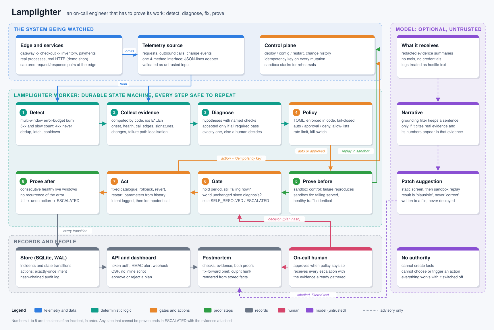

# Architecture



## The design position

Published benchmarks agree on where language-model on-call agents fail. On OpenRCA (ICLR 2025) the best
agent solved 11.34% of real failure cases; on ITBench (ICML 2025) agents resolved 13.8% of SRE scenarios. A
2026 failure analysis of 1,675 agent runs found the dominant pitfalls were hallucinated data interpretation
and incomplete exploration, in every model tier, and that prompt engineering alone did not fix them. The
automated-program-repair literature adds a second warning: a patch that passes the available tests is only
"plausible", and may still be wrong.

Newer models do better (a third-party leaderboard lists one at 34.9% on OpenRCA), which is still far from
something to hand production to unsupervised. Sources are listed at the end.

Lamplighter is built around those findings rather than against them:

1. **Facts are computed, never generated.** Every number in a diagnosis comes from code reading telemetry.
2. **A diagnosis is a set of checks, not a paragraph.** A hypothesis is accepted only when all of its
   required checks pass, and each check cites the evidence it used.
3. **Correlation is not enough to act.** Before a rollback or a config revert, the failure must reproduce in
   an isolated copy of the current state and disappear in a copy with the fix (a controlled experiment).
4. **"Done" means proven.** An action is followed by consecutive healthy windows of live traffic with no
   recurrence of the incident's error, or it is undone and a human is paged.
5. **The model has no authority.** It writes a filtered narrative and an optional patch suggestion. It
   cannot create a fact, choose an action, or supply a parameter. Everything works with it switched off.

## Components

| Module | Responsibility |
|---|---|
| `telemetry.py` | `TelemetrySource` interface (requests, calls, changes, catalog) and the JSON-lines adapter. Records are validated; malformed ones are skipped and counted. |
| `detect.py` | Multi-window error-budget burn on the edge SLO. Server errors and slow requests count; client errors never do. |
| `evidence.py` | Onset search, per-service health against a baseline, call-edge health, error signatures, release split, change events, and failure-path localisation. Produces evidence items `E1..En`, each with a locator. |
| `reason.py` | Builds hypotheses (`bad_release`, `bad_config`, `service_degraded`, `process_down`, `external_dependency`, `unexplained_errors`) with required and supporting checks, and the remediation plan with its inverse. |
| `policy.py` | TOML policy enforced in code: mode, per-action tier, service allow-lists, hourly rate limit, kill switch. Fail-closed. |
| `replay.py` | Cuts failing and golden cases from captured edge traffic and replays them against a sandbox. |
| `prove.py` | Preflight (control and fix replays) and postflight (live windows, signature recurrence). |
| `actions.py` | The only code that changes anything: a fixed action catalogue over the control-plane API, with idempotency keys and a staleness precondition. |
| `orchestrator.py` | The durable state machine, single-worker lease, retries, deduplication, latch and cooldown. |
| `store.py` | SQLite (WAL): incidents, actions, approvals, and a hash-chained audit log. |
| `fixforward.py` | Culprit localisation from stack frame and release diff; optional model patch with static screen and sandbox replay. |
| `llm.py` | Provider clients (Anthropic Messages API, OpenAI-compatible), redaction, and the grounding filter. |
| `api.py`, `static/` | Authenticated API, HMAC alert webhook, Prometheus metrics, dashboard with a strict CSP. |

## The incident state machine

```
DETECTED ──> [AWAITING_APPROVAL] ──> PREFLIGHT ──> GATE ──> ACTING ──> VERIFYING ──> RESOLVED
   │                 │                   │           │         │           │
   │                 │                   │           │         │           └─> REVERTING ──> ESCALATED
   │                 │                   │           └─> SELF_RESOLVED (it stopped on its own)
   └─────────────────┴───────────────────┴─> ESCALATED (no safe, proven action)
```

- **DETECTED** collects evidence and diagnoses on every tick until one hypothesis is accepted, the alert
  clears, or the hold period has passed twice without a conclusion.
- **PREFLIGHT** runs the two sandbox replays. A plan whose failure does not reproduce, or whose fix does not
  pass, is refuted and never runs.
- **GATE** waits out the hold period, then requires that the service is still failing in the freshest
  window, that the world still matches the plan (the release or value the plan expects is still in place),
  and that policy still allows the action.
- **ACTING** records the intent, then makes one idempotent call. A lost response or a crash is retried with
  the same key, so the change is applied at most once.
- **VERIFYING** needs consecutive healthy windows. On timeout, an action with an inverse is undone.

Every transition is one SQLite transaction that also appends to the audit chain.

## How a diagnosis is decided

Localisation walks from the edge toward the origin. At each hop: if most failures were raised locally, stop.
If most are blamed on one dependency, follow it only when that dependency is unhealthy by its own telemetry
or unreachable. If the dependency looks healthy from its own side, the fault is on the caller's side of the
call (configuration, network), and the walk stops at the caller.

Required checks per hypothesis:

| Hypothesis | Required checks |
|---|---|
| `bad_release` | the deploy precedes onset; failures originate in that service; its dominant error is new and raised by its own code; no later deploy supersedes it |
| `bad_config` | the change precedes onset; failures are on the call the setting governs while the dependency is healthy on its own side; no later change of the key |
| `service_degraded`, `process_down` | the failure path ends at the service; it is unhealthy by its own telemetry or unreachable; no recent change to it |
| `external_dependency` | the failure path ends at a service the catalogue marks external; never actionable |
| `unexplained_errors` | local errors with no change to explain them; never actionable |

Exactly one accepted hypothesis is a diagnosis. Zero or several ends in ESCALATED with the checks attached.

## Reliability properties, and the tests that hold them

| Property | Mechanism | Test |
|---|---|---|
| An action is applied at most once | intent row + idempotency key honoured by the control plane | `test_lost_response_does_not_cause_a_second_action`, `test_lamplighter_crash_mid_incident_resumes_and_acts_exactly_once` |
| A crashed worker resumes | all state in SQLite; steps are repeatable; lease expiry | `test_worker_restart_resumes_without_repeating_the_action` |
| No action on a blip | hold period + freshest-window check | `test_self_resolved_incident_is_left_alone`, scenario `transient_blip` |
| No action on a stale plan | precondition against control-plane state | `test_stale_plan_is_not_executed` |
| A fix that does not work is undone | postflight timeout triggers the inverse | `test_failed_proof_undoes_the_action_and_escalates` |
| No duplicate incidents | one open incident per service, latch until the alert clears, cooldown | `test_no_duplicate_incident_while_one_is_open_or_just_closed` |
| The audit log is tamper-evident | SHA-256 chain over every entry | `test_audit_chain_detects_tampering`, `test_audit_chain_detects_deletion` |

## Adapting it to a real system

The demo shop is the only system it has run against. To point it at something else you implement two
interfaces and write a catalogue:

- `TelemetrySource` over your metrics, logs or traces, and your change feed (deploys, config, flags).
- `Actuator` over your deploy system, including a way to stand up an isolated copy for rehearsals.
- A service catalogue: dependencies, the edge SLO, and which services are managed, restart-safe or external.

The current sandbox interface assumes one service with releases and config (`checkout_url` in the reply),
which is a demo simplification you would generalise first.

## Known limits

- Detection reads the edge's own request log. If no requests reach the edge at all, nothing fires; a real
  deployment needs synthetic probes.
- Localisation follows error attribution. A slowdown with no failed requests is only followed when exactly
  one dependency is unhealthy.
- One fault at a time. Overlapping faults usually produce zero or several accepted hypotheses, which is
  ESCALATED by design.
- A crash or hang shortly after a deploy or setting change to the same service is escalated rather than
  restarted, because the change cannot be ruled out as the cause. The demo's fault buttons wait until the last
  change has left that window (30 seconds in the demo timing profile) so each fault is a single-cause test.
- A restart cannot be rehearsed, so it has no preflight; it is proven only afterwards.
- Undoing a failed rollback re-deploys the release that was rolled back. That restores the state a human
  last chose, on the reasoning that a rollback which did not help was aimed at the wrong cause.
- The worker is a single process guarded by a 30 second lease. A step that blocks longer than the lease
  (a slow model call after closing, a long preflight) could overlap with a second worker; actions stay
  safe because of the idempotency keys, but the design is single-worker, not highly available.
- The diagnosis rules cover five cause classes. Anything else is reported, not fixed.

## Sources for the design position

- OpenRCA: Xu et al., "OpenRCA: Can Large Language Models Locate the Root Cause of Software Failures?", ICLR 2025. https://iclr.cc/virtual/2025/poster/32093
- ITBench: Jha et al., "ITBench: Evaluating AI Agents across Diverse Real-World IT Automation Tasks", ICML 2025. https://arxiv.org/abs/2502.05352
- Failure analysis of LLM-based RCA agents over 1,675 runs. https://arxiv.org/abs/2602.09937
- Evidence audits and mined rules on OpenRCA: "How Far Can Root Cause Analysis Go on Real-World Telemetry Data?" https://arxiv.org/abs/2607.13548
- Test overfitting in LLM program repair: Ahmed and Ganhotra, "Is the Cure Still Worse Than the Disease?" https://arxiv.org/abs/2511.16858
- OpenRCA third-party leaderboard entry. https://llm-stats.com/benchmarks/openrca
- Multi-window, multi-burn-rate alerting: Google SRE Workbook, "Alerting on SLOs". https://sre.google/workbook/alerting-on-slos/
